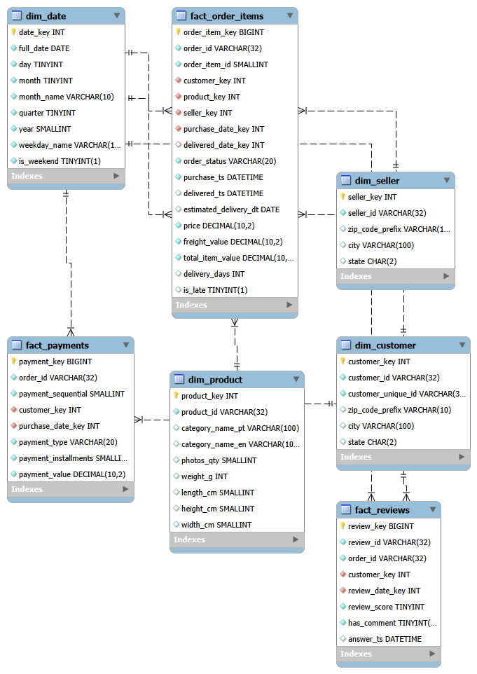

# E-Commerce Data Warehouse (Olist)

A MySQL data warehouse for analysing e-commerce activity, built from the Brazilian Olist public dataset. Raw data from a SQLite file is cleaned with Python (pandas), loaded into a **star schema** in MySQL, and analysed with SQL (CTEs and window functions).

## Goals

- Design a star schema (fact and dimension tables) for e-commerce data
- Build a repeatable ETL pipeline: extract, transform, load
- Answer business questions on sales, products, sellers, delivery, payments and customers with analytical SQL

## Tech stack

- **MySQL 8** and **MySQL Workbench** (warehouse and queries)
- **Python 3** with pandas, SQLAlchemy and PyMySQL (ETL)
- **SQLite** (source data)

## Dataset

[Brazilian E-Commerce Public Dataset by Olist](https://www.kaggle.com/datasets/terencicp/e-commerce-dataset-by-olist-as-an-sqlite-database), downloaded as a single SQLite file (`olist.sqlite`) and placed in the `data/` folder. It is not included in this repository because of its size.

## Star schema



**Fact tables**

| Table | Grain (one row per) | Main measures |
|---|---|---|
| `fact_order_items` | order item | price, freight_value, total_item_value, delivery_days, is_late |
| `fact_payments` | payment of an order | payment_value, payment_installments |
| `fact_reviews` | customer review | review_score |

**Dimension tables**

| Table | Description |
|---|---|
| `dim_customer` | customer location; keeps both `customer_id` (per order) and `customer_unique_id` (the real person) |
| `dim_seller` | seller location |
| `dim_product` | product category (Portuguese and English) and physical attributes |
| `dim_date` | calendar attributes: day, month, quarter, year, weekday, weekend flag |

## Data loaded

| Table | Rows |
|---|---|
| dim_customer | 99,441 |
| dim_seller | 3,095 |
| dim_product | 32,951 |
| dim_date | 1,096 |
| fact_order_items | 112,650 |
| fact_payments | 103,886 |
| fact_reviews | 99,224 |

The ETL checks its own work: total item revenue in the source (13,591,643.70) matches the warehouse exactly.

## Project structure

```
ecommerce-data-warehouse/
├── data/
│   └── olist.sqlite              (download separately, not committed)
├── docs/
│   └── schema_diagram.png
├── etl/
│   └── load_warehouse.py         (extract, transform, load)
├── sql/
│   ├── create_schema.sql         (creates the olist_dw database and tables)
│   └── analytics_queries.sql     (analytical queries)
├── requirements.txt
└── README.md
```

## Setup and usage

**1. Prerequisites:** Python 3, MySQL Server 8 and MySQL Workbench installed, and the MySQL service running.

**2. Get the data:** download `olist.sqlite` from the Kaggle link above and put it in `data/`.

**3. Install Python libraries:**

```
pip install -r requirements.txt
```

**4. Create the database and tables:** in MySQL Workbench, open `sql/create_schema.sql` (File > Open SQL Script) and run it with the lightning bolt button. This creates the `olist_dw` database with 7 tables.

**5. Run the ETL** from the project root:

```
python etl/load_warehouse.py
```

Enter your MySQL username (default `root`), your password (typing is hidden) and the host (default `localhost`). The script clears the warehouse tables, loads the dimensions, then the facts, and finishes with a verification summary. It is safe to re-run.

**6. Run the analysis:** open `sql/analytics_queries.sql` in Workbench, click inside one query and press `Ctrl + Enter`.

## ETL overview

1. **Extract:** reads 8 source tables from SQLite (customers, sellers, products, category translation, orders, order items, payments, reviews).
2. **Transform:**
   - parses date and timestamp columns
   - builds the date dimension covering every date in the data
   - joins the English category names onto products (falls back to the Portuguese name when no translation exists)
   - standardises city and state text and zero-pads ZIP prefixes
   - calculates `total_item_value`, `delivery_days` and an `is_late` flag
3. **Load:** inserts dimensions first, reads back the generated surrogate keys, then loads the fact tables with those keys.
4. **Verify:** compares row counts and total revenue between source and warehouse.

## Analytical queries

`sql/analytics_queries.sql` contains 11 queries:

| # | Question | Techniques |
|---|---|---|
| Q1 | Monthly revenue, running total and month-over-month growth | CTE, `SUM() OVER`, `LAG` |
| Q2 | Average order value and order count by month | aggregation |
| Q3 | Top 10 product categories and their share of revenue | `SUM(SUM()) OVER ()` |
| Q4 | Top 3 categories per year | `RANK() OVER (PARTITION BY ...)` |
| Q5 | Top 10 sellers by revenue | joins |
| Q6 | Revenue by customer state | joins, share of total |
| Q7 | Delivery time and late-delivery rate by state | CTE, order-level grain |
| Q8 | Do late deliveries get lower review scores? | joins across fact tables |
| Q9 | Payment type mix | aggregation, share of total |
| Q10 | Repeat vs one-time customers | CTE, `customer_unique_id` |
| Q11 | Customer segments from recency and spend | `NTILE(4)`, `CASE` |

Orders with status `canceled` or `unavailable` are excluded from revenue analysis.

### Sample results

**Monthly revenue and growth (Q1)**


**Top product categories (Q3)**


**Delivery performance by state (Q7)**


**Customer segments (Q11)**


## Design decisions

- **Grain:** the main fact table has one row per order item, so revenue questions are simple sums.
- **Separate payments and reviews facts:** both are order-level, so joining them onto items would double-count money.
- **Customer identity:** Olist creates a new `customer_id` for every order, so repeat-customer analysis uses `customer_unique_id`.
- **Surrogate keys:** dimensions use integer surrogate keys; source ids are kept as business keys.
- **Not loaded:** the `geolocation` table (1M noisy rows) and the marketing `leads_*` tables are out of scope for this analysis.

## Possible extensions

- Add a geolocation dimension (latitude and longitude averaged per ZIP prefix)
- Load review comment text for sentiment analysis
- Schedule the ETL with Airflow
- Build a dashboard on top of the warehouse
